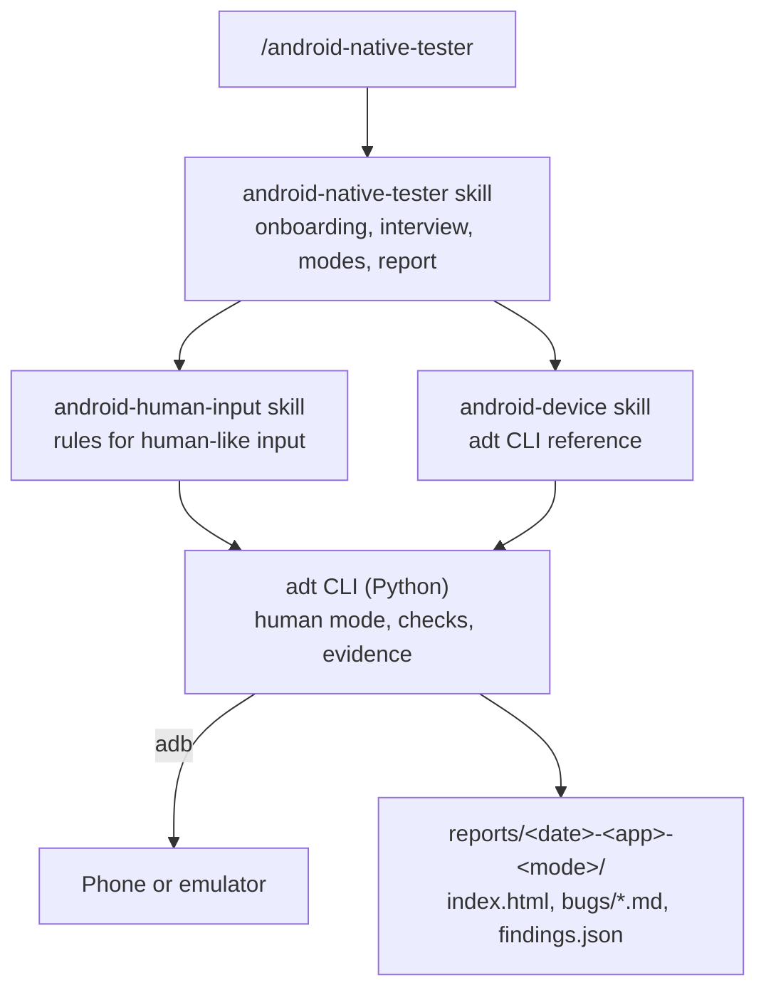

# Android Tester for Claude Code

**Let Claude test your Android app on a real phone or emulator, the way a person would, and hand you a QA report you can act on.**

`/android-native-tester` runs exploratory testing, written test cases, bug reproduction and UI/accessibility reviews on any Android app.
It drives the device with human-like input, checks every step, records evidence, and ends each session with a standard report and Jira-ready bug drafts.

```
/android-native-tester explore com.example.app
```

## Why this exists

AI agents can already drive a phone over `adb`.
The trouble is *how* they drive it:

- **Raw adb input is not human input.**
  `adb shell input tap` is a zero-millisecond touch on an exact pixel.
  `input text` pastes a whole string past the keyboard.
  `KEYCODE_BACK` is not the back swipe that gesture-navigation users make.
  Apps, especially WebView and React Native apps, can react differently to each of these.
- **So automation finds bugs that people can't reproduce, and misses ones they hit.**
  While building this plugin, one "bug" reproduced in 17 of 18 automated runs and in 0 of 2 attempts by a person on the same phone.
  An agent left to itself would have filed it as a confirmed Major bug.
- **Agents act faster than any person, and blindly.**
  A tap swallowed by an overlay, or sent to coordinates from a stale screen, goes unnoticed, and every later step is invalid.
- **Without knowing the app, an agent tests generic things.**
  It checks what apps of some other kind usually do, not what *this* app is supposed to do.
- **Reports come out different every time,** with missing environment details, steps that can't be followed, and no evidence.

This plugin addresses each of these, with rules the model follows and a CLI that enforces them.

## Main benefits

- **Human-like input by default.**
  60-150 ms presses at a random point near the center of an element (never on a covering control), a short think pause before each action, back and home gestures that match the device's navigation mode, and typing through the real on-screen keyboard.
- **Every action is checked.**
  After each step the CLI waits for the screen to settle and warns when nothing visibly changed, so a swallowed tap is caught at once.
- **Honest bug status.**
  A bug reproduced only by automation is reported as *Unconfirmed*, with automated and manual reproduction counts kept apart.
  The skill offers a recorded manual-reproduction run and compares it frame by frame with the automated one.
- **App-independent, but app-aware.**
  The skills carry no assumptions about any kind of app.
  Onboarding asks you to describe your app (purpose, users, main flows, rules, roles, glossary), and every session judges behaviour against that description and the ticket.
- **A standard QA report every time.**
  Severity and priority, status, environment (device, Android version, navigation mode, keyboard, locale, build and its source), preconditions, steps, expected and actual results, N-of-M reproducibility, screenshots and a video clip per bug.
  The data is validated before the HTML report is built.
- **Evidence without busywork.**
  Screen recording with exact timestamps, a timed log of every action, logcat with crash and ANR extraction, and one-command clip cutting per bug.
- **Safe on your personal phone.**
  Payments, outgoing messages, account changes, accepting terms, and system-setting changes stop and ask, whatever the configuration says.
  Builds from outside a store are checked (signers, splits, permissions) before installing.
- **Auto mode when you want it.**
  Approve defaults for routine decisions once (permission prompts, consent banners, login, crash handling) and the session runs without stopping, logging every decision it made for you.
- **Jira-friendly.**
  Link a ticket (read through the Atlassian connector, or paste it), and get one Markdown bug draft per finding.
  Nothing is created in Jira without your explicit approval.

## How it works



| Skill | Starts | Purpose |
|---|---|---|
| `android-native-tester` | When you type `/android-native-tester`, or ask in plain words to test an app ("explore the Notes app for 15 minutes") | Onboarding on first use, the session interview, a session in one of six modes, the standard report |
| `android-human-input` | Automatically, whenever a device is driven | The rules for human-like input and honest reproduction |
| `android-device` | Automatically | Reference for the `adt` command-line tool that does the device work |

## Requirements

- [Claude Code](https://code.claude.com) (CLI, desktop app or IDE extension).
- Android SDK Platform-Tools (`adb`).
- [uv](https://docs.astral.sh/uv/), which runs the bundled Python tool with its dependencies; no manual Python setup.
- `ffmpeg` and `ffprobe` for joining recordings and cutting bug clips.
- Optional: a JDK (for `keytool`) or `openssl`, to show certificate owners when inspecting APKs.
- Optional: [scrcpy](https://github.com/Genymobile/scrcpy), to watch the phone on your computer while Claude drives it.

### Windows

```bash
winget install --id Google.PlatformTools -e
```
```bash
winget install --id astral-sh.uv -e
```
```bash
winget install --id Gyan.FFmpeg -e
```
```bash
winget install --id EclipseAdoptium.Temurin.21.JDK -e
```
```bash
winget install --id Genymobile.scrcpy -e
```

If you install Android Studio instead of Platform-Tools, the plugin finds `adb` in the default SDK folder, or wherever `ANDROID_HOME` points.

### macOS

```bash
brew install --cask android-platform-tools
```
```bash
brew install uv ffmpeg scrcpy
```
```bash
brew install --cask temurin
```

### Linux (Debian, Ubuntu, Kubuntu)

```bash
sudo apt install adb ffmpeg openjdk-21-jre-headless scrcpy
```
```bash
curl -LsSf https://astral.sh/uv/install.sh | sh
```

## Prepare your phone

1. Open **Settings > About phone** and tap **Build number** seven times to enable Developer options.
2. In **Settings > System > Developer options**, turn on **USB debugging**.
3. Connect the phone with a USB cable and accept the **Allow USB debugging?** prompt (tick "Always allow from this computer").
4. Check the connection:
   ```bash
   adb devices
   ```
   The phone should be listed as `device`, not `unauthorized`.

Some brands need their own USB driver on Windows (for example Samsung's; Pixel phones use the Google USB Driver from Android Studio's SDK Manager).
An emulator from Android Studio works too and is the better choice for tests that change system settings (font size, dark mode, rotation).

## Install the plugin

Inside Claude Code:

```
/plugin marketplace add ilivinskyi/android-tester
```
```
/plugin install android-tester@android-tester
```

On Claude Code 2.1.275 or later, one step does both:

```
/plugin install android-tester --marketplace ilivinskyi/android-tester
```

Or from a terminal:

```bash
claude plugin marketplace add ilivinskyi/android-tester
```
```bash
claude plugin install android-tester@android-tester
```

Start a new session afterwards.
Typing `/` should now list `android-native-tester`.

To try it without installing, clone the repo and load it for one session:

```bash
git clone https://github.com/ilivinskyi/android-tester.git
```
```bash
claude --plugin-dir ./android-tester
```

## Run your first session

Open Claude Code in a folder where reports and settings should live (for example a QA folder or your app's repository), then run:

```
/android-native-tester
```

Asking in plain words works too ("test the Notes app on my phone, 15 minutes"): the request loads the same skill, with your config and auto mode.

1. **Onboarding (first time only).**
   Your name for reports, the reports folder, an optional Jira project, your devices (and which one is personal), an app profile with a description of your app in your own words, whether to report problems noticed outside a session's scope (and which unfinished areas to never report), and whether to use auto mode.
   Everything is saved in `.android-tester/` so later sessions start straight away.
2. **Session interview.**
   Which app (type its name as on your phone, or its package id; Claude finds it on the device and lets you pick when several match) or build file, a ticket or context, the mode, the charter, the device, the time box, and what evidence to collect.
   The skill sums it up as a plan and waits for your go.
3. **Preparation.**
   Device check, build check and install when needed, your setup hooks, then recording and logcat start.
4. **Testing** in the chosen mode, writing findings as it goes.
5. **Wrap-up.**
   A video clip per bug, the report checked and built, an offer to reproduce unconfirmed bugs by hand, Jira drafts, and new knowledge about the app added to its notes.

### Modes

| Mode | Example | What happens |
|---|---|---|
| `explore` | `/android-native-tester explore com.example.app` | Time-boxed exploratory testing guided by a charter, the app's main flows and rules |
| `test-case` | `/android-native-tester test-case tests/TC-001.md` | Runs written test cases step by step and reports pass, fail or blocked per step |
| `repro` | `/android-native-tester repro PROJ-123` | Reproduces a reported bug, narrows the trigger one variable at a time, confirms with a person |
| `ui-review` | `/android-native-tester ui-review com.example.app` | Accessibility (touch targets, labels, contrast, screen-reader text) and visual review |
| `retest` | `/android-native-tester retest com.example.app` | Runs the regression test cases of the app's open known issues on a new build and marks each Fixed, Still reproduces or Can't verify |
| `memory` | `/android-native-tester memory com.example.app` | Repeats flows and watches live Activities, Views and memory per cycle to find leaks |

In every mode, the app's own log is checked after each action (errors, caught exceptions, network failures, out of memory), and memory is sampled every 10 actions; both end up in the report.

### After the session

- **Confirm findings by hand.** Tell Claude "B3 reproduced 2 of 2 on my phone" (or run `adt report confirm`): the finding gets a history entry, its manual count and status update, and the report is rebuilt.
- **Known issues.** Every bug lands in the app's known-issues registry with a regression test case draft. Later sessions link a known bug found again ("K-3 seen again") instead of reporting it as new, and reopen fixed issues that come back.
- **Crashes and performance.** A crash is caught at the action that caused it. Each session records cold start time, janky frames and memory, so a slower build shows up in the report.

If the short name clashes with another command, use the namespaced form `/android-tester:android-native-tester`.

## What a session produces

```
reports/2026-10-23-myapp-explore/
  index.html        the finding list: summary, findings grouped by severity, search, filters
  bugs/B1.html      one page per finding: Jira copy buttons, steps, expected and actual, evidence viewer
  bugs/B1.md        Jira-ready bug drafts, one per bug and accessibility finding
  findings.csv      every bug and accessibility finding, for Jira's CSV import
  findings.json     machine-readable findings
  session.json      device, app, ticket, charter, timing, environment
  screenshots/      evidence, with the UI hierarchy XML next to each screenshot
  videos/           session.mp4 plus one clip per bug
  logs/             actions.jsonl (every action, timed), logcat.txt, decisions.md
```

Each finding has an id, title, type (bug, accessibility, observation), severity (Blocker to Trivial), suggested priority (P1-P4), status (Confirmed, Unconfirmed, Retracted), preconditions, steps, expected and actual results, reproducibility (automated and manual N of M) and evidence.
`adt report check` rejects incomplete or misleading data, for example a Major bug marked Confirmed when only automation reproduced it.

## Project configuration

Onboarding writes this into the folder you test from:

```
.android-tester/
  config.yaml                 tester, reports, Jira, device inventory, auto mode
  apps/<package>/
    profile.yaml              what the app is and how it works (about), store URL, expected signer,
                              login method, reset strategy, hooks, risky areas
    notes.md                  what testers learn over time: screen map, quirks, known issues
    hooks/  checks/           your setup, reset, teardown and login scripts and custom checks
    known-issues.json         bugs found across sessions, their status and where they were seen
    tests/                    regression test cases, one per known issue (drafted automatically)
    secrets.local.yaml        test credentials, filled in by you (keep it out of git)
```

Add `.adt/` and `.android-tester/**/secrets.local.yaml` to your `.gitignore`; onboarding offers to do it.

## Human-like input in detail

| A person | Raw adb | This plugin (`adt`, default) |
|---|---|---|
| Presses for about 100 ms | `input tap`: 0 ms | 60-150 ms press (`input swipe` held in place) |
| Hits near the middle, never the same pixel twice | The exact center | Random point near the center, avoiding anything that covers the element |
| Looks, then acts | Instant, back to back | 0.4-1.4 s think pause, then waits until the screen stops changing |
| Notices when nothing happened | Never | Compares the screen before and after, warns on "no visible change" |
| Swipes back from the edge (gesture navigation) | `KEYCODE_BACK` | Edge swipe in gesture mode, the navigation-bar key in 3-button mode |
| Types on the keyboard, with autocorrect | `input text` pastes past the keyboard | Taps the keyboard's own keys, including shift and symbol layers |

`--fast` switches back to instant input for setup steps only (installing, resetting data, getting to the start state), and every fast step is marked in the report.

Every run that is compared with another starts from the same state: the session itself, each reproduction attempt, each test case and each retested known issue.
`adt app reset` restarts the app, or clears its data first so it is like a fresh install; which one is set per app in its profile (or an app-specific reset script), and clearing data on a personal phone is always asked first.

## Guardrails

These always stop the session and ask, even in auto mode:

- Purchases, payments, subscriptions.
- Sending messages, posts, reviews, invites or feedback.
- Account deletion, logout, password or email changes.
- Accepting terms, consent, or OAuth/SSO permissions.
- System-setting changes and clearing app data on a device marked personal.
- Installing a build that fails the signer and package checks.
- Creating or changing Jira issues.

The CLI also refuses to tap elements labelled like payment, messaging or account-destroying actions until you approve that one action.

## The `adt` command-line tool

The skills drive everything through `adt`, a small Python tool in `scripts/`, run by uv:

```bash
uv run --script scripts/adt.py doctor
```

It covers device facts, observing the screen (hierarchy plus annotated screenshot), human-like actions, app management, APK inspection, sessions, recording, clips, logcat, hooks and reports.
See [skills/android-device/reference.md](skills/android-device/reference.md) for every command.

## Limitations

- On-screen typing is tuned for Gboard with English key names; other keyboards and languages fall back to per-character key events (or ask).
- Apps are launched through their launcher intent, not by tapping the icon.
- Screens protected with FLAG_SECURE (banking apps, DRM video) record and screenshot as black.
- A UI that never goes idle (endless animation, video) can make the hierarchy dump fail; the tool falls back to screenshots.
- Inputs injected over adb come from a virtual input device, so a bug that only automation reproduces stays Unconfirmed until a person reproduces it. That's deliberate.

## Development

```bash
uv run --group dev pytest
```
```bash
uv run --group dev ruff check scripts tests
```
```bash
claude plugin validate .
```

The design decisions are in [docs/spec.md](docs/spec.md).
The tests use real UI dumps captured from devices as fixtures.

## License

[MIT](LICENSE)
